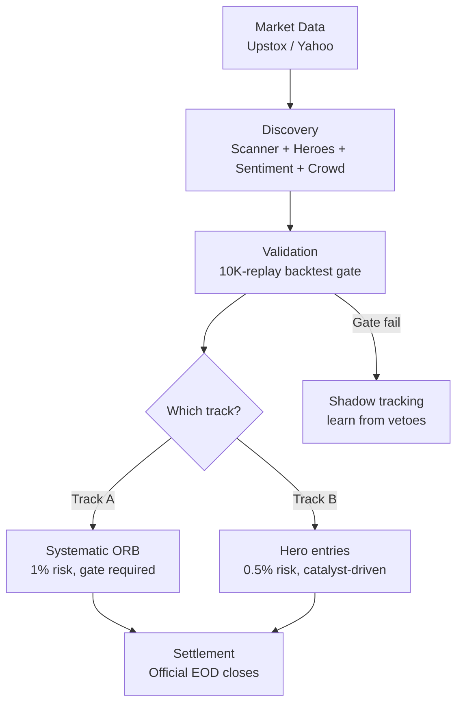

# indian-day-trade-skill

[](LICENSE)
[](https://www.python.org/)
[](https://www.nseindia.com/)
[](requirements.txt)

> Trade NSE like a machine, not a gambler — paper-trading infra with dual feeds, a 10,000-replay lie detector for every setup, and crash-proof execution. India's market, engineered.

Production-grade **paper-trading infrastructure** for NSE (National Stock Exchange of India) day trading. Systematic Opening Range Breakout (ORB) with dual-feed market data, crash-safe execution, backtest validation gates, and per-lane risk management.

> **This is engineering infrastructure, not a profitable strategy.** It demonstrates how to build *reliable* trading systems: feed failover under throttling, exact-restart recovery after crashes, a 10,000-replay backtest gate before every entry, and a paper ledger with full audit trails. Most open-source trading tools are US-focused; this is built for India's market structure from the ground up.

*Keywords: algorithmic trading, NSE, National Stock Exchange of India, intraday trading, day trading, paper trading, backtesting, market data API, Python trading bot, Indian stock market, systematic trading, quantitative trading, ORB strategy, opening range breakout, Upstox API, Yahoo Finance, risk management, portfolio*

📖 **[Full architecture →](docs/architecture.md)** — the complete pipeline: sources → discovery → validation → execution → settlement, with data-flow diagrams, failure modes, and design decisions.

## How it works



## Who is this for

- **Builders** learning how real trading infrastructure works — feed handling, validation gates, crash recovery — beyond textbook backtests.
- **NSE traders** who want a systematic starting point for intraday strategies, with honest risk defaults.
- **AI agent users** who want to point Claude/ChatGPT at a repo and get a working paper-trading setup without writing boilerplate.

**Not for:** anyone looking for a ready-made profitable strategy, live order execution, or US-market tooling.

## Data feed options

Pick the feed that fits your setup. The router (`feed/router.py`) defaults to Upstox → Yahoo fallback.

| Feed | Cost | One-line pro |
|------|------|--------------|
| **Upstox** | Free (Analytics Token, 1-yr, read-only) | Proper REST API with 1-min candles and sane rate limits — best free option |
| **Yahoo Finance** | Free, no auth | Zero setup, works for historical backfill — throttles under sustained live polling |
| **Kite Connect** | ₹2,000/mo | Official Zerodha API, reliable — expensive for paper trading |
| **Groww** | ₹499/mo + GST | Clean API — paid tier only for market data |
| **DhanHQ** | ₹499/mo + tax | Good API — paid tier only |
| **Angel One SmartAPI** | Free | Free with account — workable backup |
| **Twelve Data** | Free tier: 800 credits/day | Global coverage — too thin for intraday NSE polling |
| **Alpha Vantage** | Free tier: 25 req/day | Simple — unusable for live polling |

**Gotcha:** Upstox's Cloudflare WAF bans Python's default `urllib` User-Agent (HTTP 403). Every request must carry a browser User-Agent — handled in [`feed/upstox_feed.py`](feed/upstox_feed.py).

## Repository structure

```
├── feed/                    # Market data
│   ├── upstox_feed.py       # Upstox primary — 1m candles → 5m bars
│   ├── yahoo_feed.py        # Yahoo fallback + historical
│   └── router.py            # Dual-feed router (Upstox → Yahoo)
├── engine/                  # Execution
│   ├── lanes.py             # Dual-lane engine (Track A + Track B)
│   ├── ledger.py            # Paper P&L, position sizing, risk guards
│   └── timemachine.py       # Backtest gate — 10k replays before entry
├── discovery/               # Idea generation
│   ├── scanner.py           # NSE universe → ORB candidates (5 setups)
│   ├── sentiment.py         # English + Hinglish lexicon scorers
│   └── crowd.py             # Telegram + Google Trends signals
├── data/                    # Reference data
│   ├── nse_official.py      # Official EOD closes referee
│   └── results_calendar.py  # Earnings blocklist
├── docs/
│   ├── architecture.md      # Full infrastructure explained
│   └── setup.md             # Upstox token setup guide
└── examples/
    └── basic_orb.py         # Minimal runnable ORB example
```

## How it works (detailed)

1. **Discovery** — the scanner narrows ~1,000 liquid NSE names to ORB candidates; hero scoring ranks catalyst-driven names; sentiment and crowd signals add context.
2. **Validation** — every setup replays 10,000 times on 60 days of 5-minute history. Entry only if target-first rate beats breakeven *and* average R ≥ 0. The gate **fails closed**: no data → no trade.
3. **Execution — two tracks:**
   - **Track A (systematic):** pure ORB. Trigger on first close above OR high, stop at OR midpoint, 2R target, 1% risk. Backtest gate must pass.
   - **Track B (hero):** catalyst-driven entries on names scoring ≥ 4 on the hero rubric (filed catalysts, promoter buying, news clusters, crowd spikes). Same ORB mechanics, 0.5% risk, gate recorded but not blocking. Max 5 heroes/day.
4. **Risk** — separate ₹50,000 pools per track. Track A: 3% daily soft cap. Track B: 1.5% daily soft cap. Max 3 trades/day/lane, 1 open position per lane, never the same symbol in both lanes, flat by 15:20 IST.
5. **Settlement** — Official EOD closes are the price of record; the paper ledger reconciles every event.

## Quick start

**With an AI agent (Claude, ChatGPT, etc.):** paste this repo's link and ask it to set up the system for you — e.g. *"Set up the indian-day-trade-skill repo for paper trading RELIANCE on NSE."* The [SKILL.md](SKILL.md) gives the agent everything it needs: architecture, feed setup, strategy rules, and risk parameters.

**Manual:**

```bash
# 1. Get a free Upstox Analytics Token (see docs/setup.md)
export UPSTOX_TOKEN="your-token"   # never commit this

# 2. Run the minimal example
python examples/basic_orb.py RELIANCE
```

## Relevant links

- [Upstox API documentation](https://upstox.com/developer/api-documentation/)
- [Upstox instrument master (NSE)](https://assets.upstox.com/market-quote/instruments/exchange/NSE.json.gz)
- [NSE India](https://www.nseindia.com/) — official exchange, Bhavcopy downloads
- [NSE market timings](https://www.nseindia.com/trade/market-timings)
- [SKILL.md](SKILL.md) — skill definition for AI agents

## Status & roadmap

Active development. The system runs daily paper-trading sessions; components are extracted here as they stabilise. Planned: full engine loop, prep-session orchestration, shadow-tracking analytics.

## FAQ

**Is this a profitable trading strategy?**
No. This is infrastructure for *building and testing* strategies reliably. The ORB example is a starting template, not a proven edge. Paper-trade any strategy for weeks before considering real capital.

**Why no broker integration?**
Deliberate. The paper phase validates feeds, gates, risk, and recovery without financial risk. Wiring up live orders is a separate decision with real consequences — it shouldn't happen by accident in a library.

**Can I use this for US markets?**
The architecture (dual-feed, backtest gate, paper ledger) is transferable, but the components are NSE-specific: IST session times, Upstox feed, Hinglish sentiment, Official EOD closes. You'd need to swap the feed and calendar layers.

**How is this different from backtesting libraries like Backtrader or Zipline?**
Those are *backtesting frameworks* — you bring the strategy, they simulate history. This is *live-system infrastructure* — feed failover, crash recovery, validation gates, and a paper ledger for running against real-time data. Complementary, not competing.

**What does the 10,000-replay gate actually do?**
Before any live entry, the setup is simulated 10,000 times against 60 days of 5-minute bars. It enters only if the target-first rate beats breakeven *and* average R is non-negative. If historical data is unavailable, the gate vetoes (fail-closed) rather than guessing.

## Contributing

Pull requests welcome. Keep these principles:
- **Paper-first:** no broker order integration in PRs.
- **Fail-closed:** new validations veto on uncertainty, never guess.
- **No credentials:** tokens in env vars, never in code or tests.
- **Explain the why:** every non-obvious choice gets a comment.

## Disclaimer

Educational infrastructure. Not financial advice. Past paper performance does not predict future results. Paper-trade before considering live capital.

## License

MIT — see [LICENSE](LICENSE).
